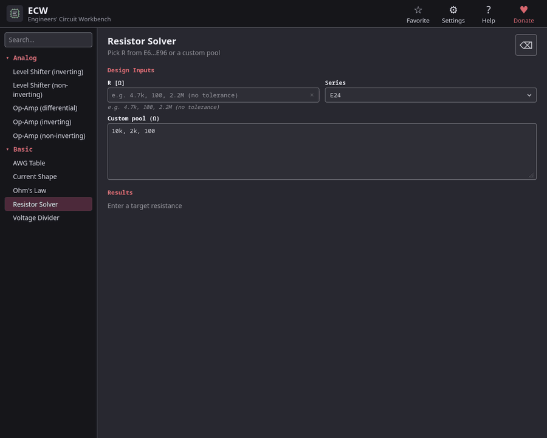
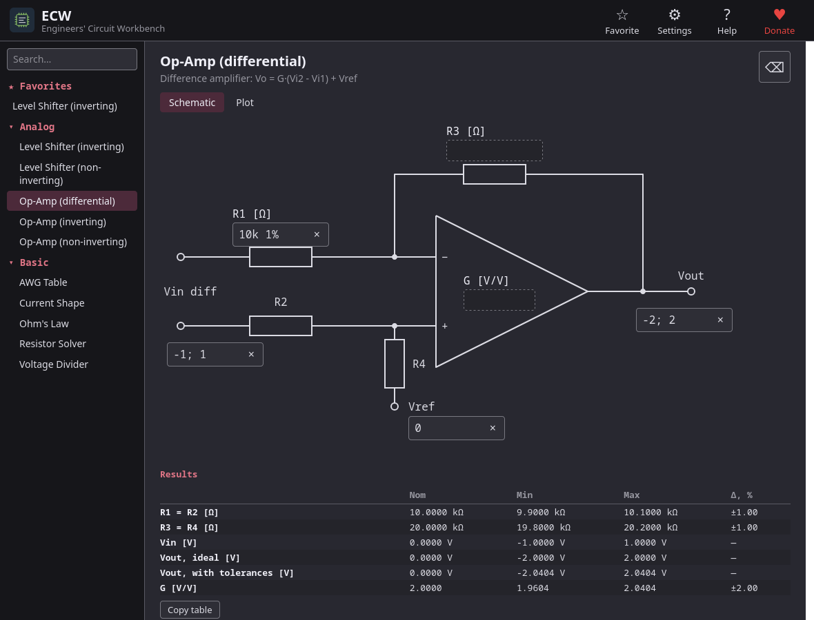
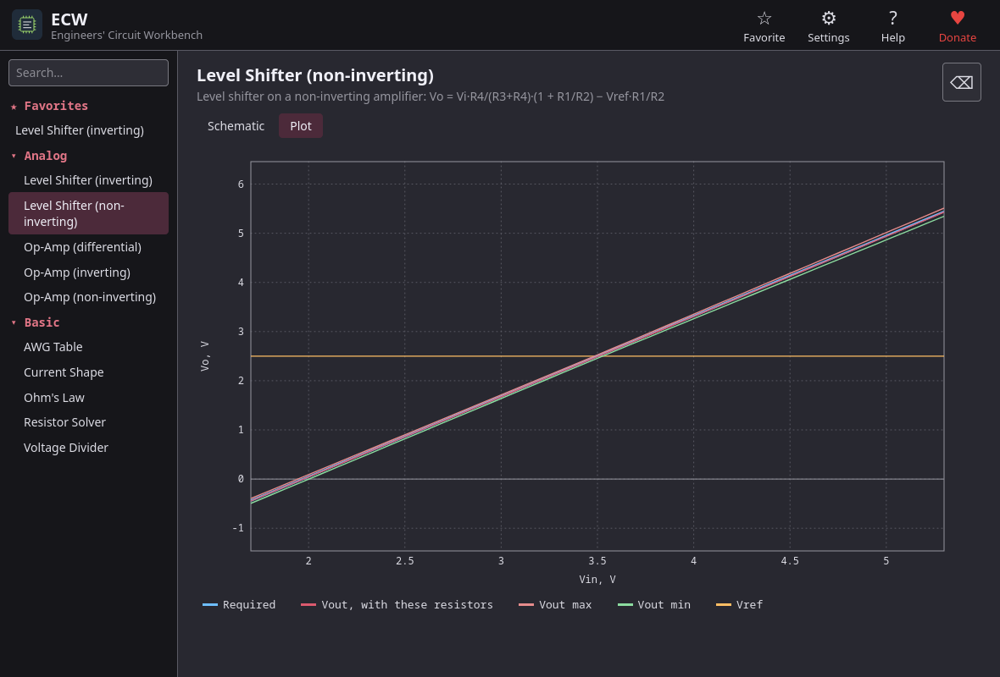
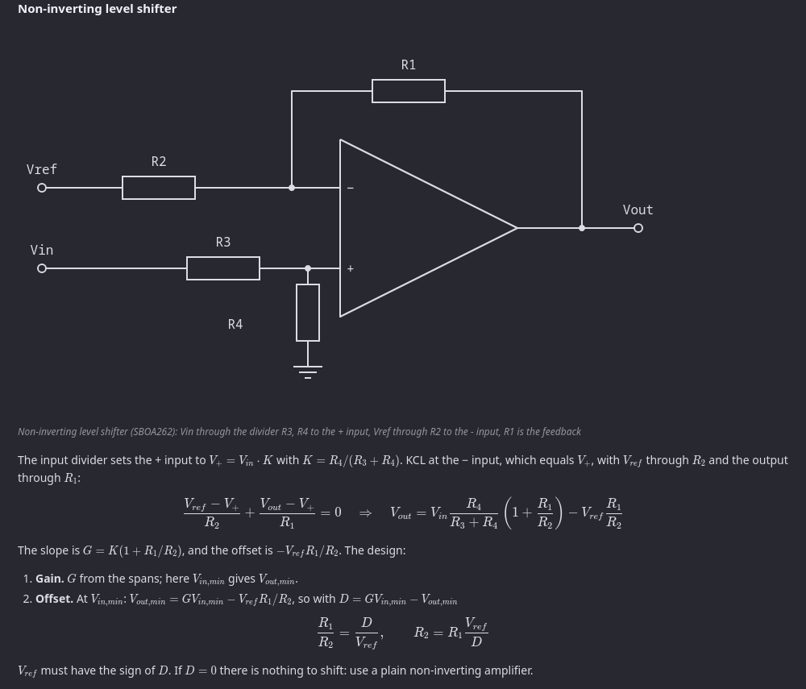

<p align="center"></p>

# ECW — Engineers' Circuit Workbench

[English](README.md) · **Русский** · [Esperanto](README.eo.md)

*Быстрые расчёты. Практическая инженерия.*

**Небольшие целевые калькуляторы для повседневной работы инженера-электронщика.**

Вы вводите те значения, которые вам известны, а программа сама пытается вычислить все остальные величины: номиналы резисторов, коэффициенты усиления, диапазоны сигналов, действующие значения токов. Значения можно вводить с допуском (`10k 1%`): он учитывается в расчётах. Встроенная справка не только объясняет, как пользоваться программой, но и подробно описывает порядок выполнения расчётов со всеми формулами.



## Возможности

- **Вводите то, что знаете.** Ни режимов, ни кнопки *Рассчитать*: введите любой достаточный набор значений, остальные будут вычислены.
- **Допуски везде, где они важны.** Наихудший случай считается точным перебором крайних сочетаний, а не оптимистичным номиналом.
- **Схемы как формы.** На страницах ОУ и смещения уровня значения вводятся прямо в схему; вкладка **Plot** показывает передаточную линию и полосу допуска.
- **Справка как учебник (F1).** Для каждого калькулятора есть теория, порядок расчёта со всеми формулами, разобранные примеры и ссылки на документы и стандарты.
- **Инженерный ввод.** Приставки СИ (`4.7k`, `100n`, `2.2M`), диапазоны (`-5; -1`), несимметричные допуски (`10k +5% -1%`).
- **Английский, русский и эсперанто**: интерфейс и справка.
- **Офлайн-приложение** для Windows, macOS и Linux.

## Калькуляторы

| Калькулятор | Что делает | Основа |
|---|---|---|
| **Закон Ома** | любые две величины из U, I, R, P дают все остальные | |
| **Делитель напряжения** | два или три резистора; любые три (или четыре) величины дают все остальные | |
| **Подбор резисторов** | ближайший стандартный номинал и лучшие последовательные и параллельные пары из рядов E6…E96 или из вашего набора резисторов | IEC 60063 |
| **Таблица AWG** | сопротивление, падение напряжения, мощность и нагрев медного провода, от 40 AWG до 4/0 | ASTM B258 |
| **Форма тока** | действующее и среднее значение тока, скважность для шести форм тока | |
| **ОУ (инвертирующий, неинвертирующий, дифференциальный)** | коэффициент усиления, резисторы и диапазоны сигналов; учитываются допуски | дифференциальный: TI [SBOA274](https://www.ti.com/lit/SBOA274) |
| **Смещение уровня (инвертирующий, неинвертирующий)** | рассчитывает усиление и смещение уровня входного сигнала, подсказывает необходимое значение опорного напряжения | TI [SBOA261](https://www.ti.com/lit/SBOA261), [SBOA262](https://www.ti.com/lit/SBOA262) |

| Дифференциальный усилитель | График с полосой допуска |
|---|---|
|  |  |



## Установка

Скачайте файл для вашей системы со страницы [Releases](https://github.com/zvladimir/ecw/releases).

Устанавливать ничего не нужно: в каждом релизе есть Windows `.exe` и Linux `.AppImage`, которые запускаются как есть (и намного меньший обычный бинарник для Linux `ecw-<версия>-linux-x86_64` для систем, где уже есть WebKitGTK 4.1 и GTK 3: `chmod +x` и запуск), файл `SHA256SUMS` и `ecw-<версия>-web.html`: те же калькуляторы одним html-файлом с WebAssembly внутри, для компьютеров, где нельзя запускать программы. Откройте его двойным щелчком в любом современном браузере: сервер и интернет не нужны.

## Сборка из исходников

Нужны [Rust](https://www.rust-lang.org/tools/install) 1.88 или новее и системные библиотеки Tauri 2 (в Linux: WebKitGTK и компания, см. [требования Tauri](https://v2.tauri.app/start/prerequisites/)).

```sh
git clone https://github.com/zvladimir/ecw.git
cd ecw
cargo run -p ecw                    # запустить приложение
cargo test -p ecw-core              # модульные, golden- и контрактные тесты
cargo build -p ecw --release        # оптимизированный бинарник в target/release
```

Файлы релиза делает Tauri CLI: `cargo install tauri-cli`, затем `cargo tauri build --no-bundle` (голый исполняемый файл) или `cargo tauri build --bundles appimage`.

Браузерная версия: `rustup target add wasm32-unknown-unknown`, `cargo install wasm-bindgen-cli --locked` (той же версии, что `wasm-bindgen` в `Cargo.lock`), затем `./scripts/build-web.sh` создаёт `target/web/ecw.html` (единый файл упаковывает Python 3).

## Участие в разработке

Отчёты об ошибках с введёнными значениями, ожидаемым результатом и источником формулы очень приветствуются. Чтобы добавить калькулятор, см. [CONTRIBUTING.md](.github/CONTRIBUTING.md): там по шагам описаны физика, API, тексты, страница и тесты.

## История

Версия 0.2 — переписывание в виде приложения на Tauri. Первая версия, *Electrical Calculations Wizard* 0.1a (Rust + iced, закон Ома и делитель напряжения), осталась в истории этого репозитория.

## Лицензия и поддержка

ECW — свободное программное обеспечение под [лицензией MIT](LICENSE). Если программа экономит вам время, разработку можно поддержать на [Boosty](https://boosty.to/desialsi).
